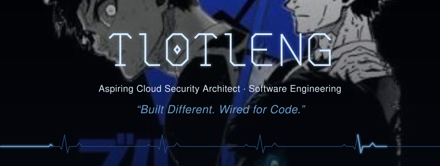

<!-- ============================================================
Tlotleng-99 · GitHub Profile README
Design: "Midnight Cobalt" (derived from the profile picture)
Palette: #050912 ink · #0B1F3D navy · #6C9FD0 cobalt accent
#DCE8F5 primary text · #9DB4CE secondary text · #23446E borders
This file must live in a PUBLIC repository named exactly: Tlotleng-99/Tlotleng-99
Also required in the SAME repository (top level): banner.svg and tech-marquee.svg
============================================================ -->

<!-- 1 · BANNER (animated; needs banner.svg in the repository root) -->

 

<!-- 2 · PROFESSIONAL INTRODUCTION -->

### Building solutions. Engineering ideas. Exploring technology.

Software engineering diploma student with a focus on **cloud computing** and a long-term goal of becoming a **Cloud Security Architect**.

 

<!-- 3 · ABOUT ME -->
<h2 align="center">About Me</h2>

<table align="center" width="100%">
<tr>
<td width="55%" valign="top">

Software engineering student passionate about <b>Java</b>, <b>Python</b>, <b>cloud computing</b>
and building practical technology solutions.

I'm working toward a career in <b>cloud security architecture</b>, combining solid
software engineering foundations with a security-minded approach to the cloud.

</td>
<td width="45%" valign="top">
<b>Studying</b> &nbsp;·&nbsp; Software Engineering, IT &amp; Computer Science 
<b>Direction</b> &nbsp;·&nbsp; Aspiring Cloud Security Architect 
<b>Languages</b> &nbsp;·&nbsp; Java, Python, VB.NET, JavaScript 
<b>Web</b> &nbsp;·&nbsp; HTML, CSS 
<b>Cloud &amp; Data</b> &nbsp;·&nbsp; AWS, SQL 
<b>Tooling</b> &nbsp;·&nbsp; Git, GitLab, Docker
</td>
</tr>
</table>

<!-- 4 · TECHNICAL SKILLS (scrolling row — needs tech-marquee.svg in the repository root) -->
<h2 align="center">Technical Skills</h2>

 

<!-- 5 · GITHUB STATISTICS -->
<h2 align="center">GitHub Statistics</h2>

<table align="center" width="100%">
<tr>
<td width="50%" align="center">

</td>
<td width="50%" align="center">

</td>
</tr>
<tr>
<td colspan="2" align="center">

</td>
</tr>
<tr>
<td colspan="2" align="center">

</td>
</tr>
</table>

<!-- 6 · FEATURED PROJECTS (both repository names verified) -->
<h2 align="center">Featured Projects</h2>

<table align="center" width="100%">
<tr>
<td width="50%" align="center" valign="top">

 
<b>CloudLink Serverless</b> 
Serverless URL shortener 
<a href="https://github.com/Tlotleng-99/cloudlink-serverless">View repository →</a>
</td>
<td width="50%" align="center" valign="top">

 
<b>DevPath</b> 
Collaborative developer learning platform 
<a href="https://github.com/Tlotleng-99/DevPath">View repository →</a>
</td>
</tr>
</table>

<!-- 7 · EDUCATION & CERTIFICATIONS
Certifications are intentionally omitted until you have earned and can link one. -->
<h2 align="center">Education</h2>

<table align="center" width="100%">
<tr>
<td width="50%" valign="top" align="center">
<b>Software Engineering</b> 
WeThinkCode_
</td>
<td width="50%" valign="top" align="center">
<b>Information Technology &amp; Computer Science</b> 
EWC
</td>
</tr>
</table>

 

<!-- 8 · CONTACT & SOCIAL LINKS -->
<h2 align="center">Contact</h2>

  

Open to learning, collaboration and new opportunities in software engineering and cloud security.

 

<!-- FOOTER -->
